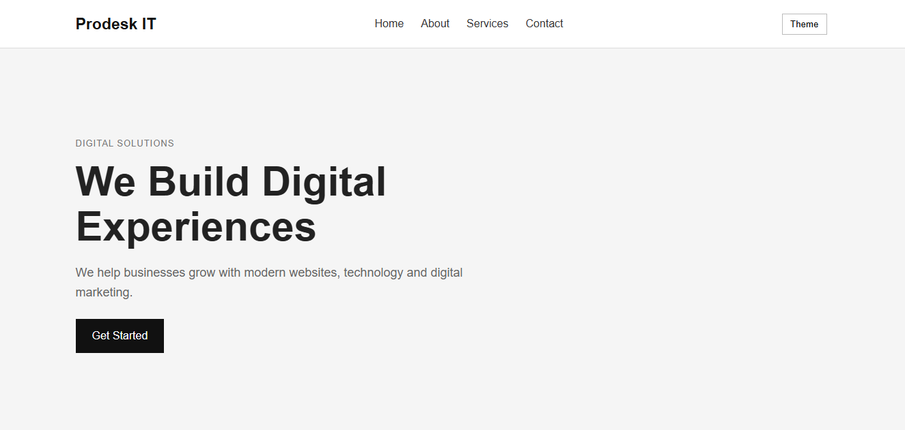

# Prodesk IT - Digital Landing Page

A responsive landing page created as part of Sprint 1 of my Prodesk IT internship.

## About

This project is a professional landing page for Prodesk IT's digital marketing wing. It includes a responsive navigation bar, hero section, about section, services section, contact section and footer.

## Features

- Responsive design
- Sticky navigation bar
- Mobile navigation menu
- Dark and light theme
- Service cards with hover effects
- Responsive layout using CSS Grid and Flexbox

## Technologies Used

- HTML5
- CSS3
- JavaScript

## Project Structure

```text
Sprint-1/
├── index.html
├── style.css
├── script.js
├── README.md
└── Prompts.md

## Screenshot



## Live Demo

https://prodesk-sprint-1-sigma.vercel.app/
